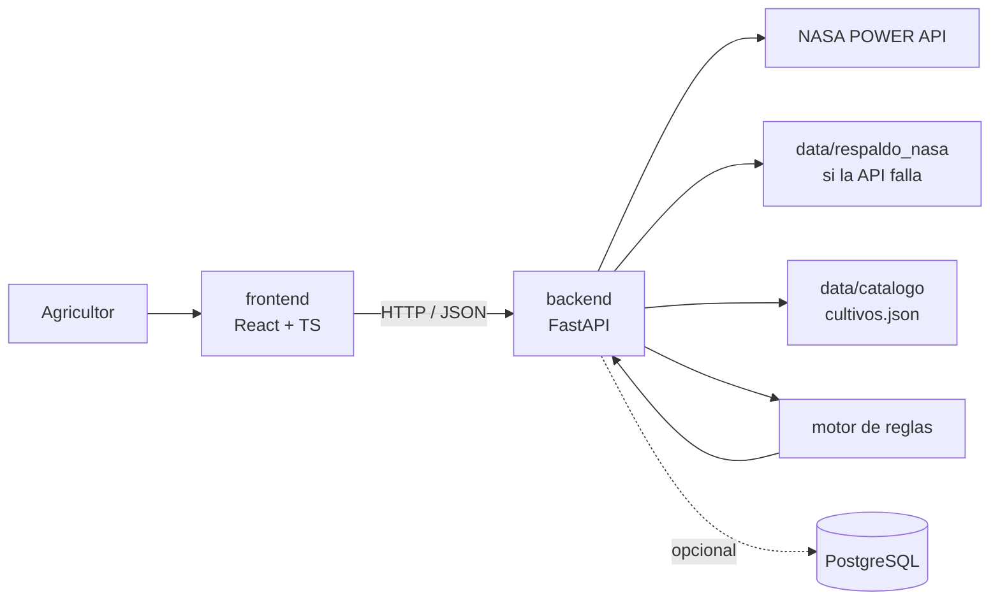

# Arquitectura de AgroShift AI

Basada en la seccion 6 de la propuesta (`docs/propuesta/AgroShift_AI_Propuesta_NASA_Space_Apps_2026.docx`).

## Estructura del monorepo

```
DesafioPrueba2/
├── frontend/              # React + TypeScript + Tailwind (Vercel)
│   ├── src/
│   │   ├── components/    # mapa, ficha de suelo, deslizadores, graficos
│   │   ├── pages/         # pantallas
│   │   ├── services/      # llamadas a la API (fetch)
│   │   └── types/         # tipos de TypeScript compartidos
│   └── prototipos/        # HTML de pruebas anteriores
├── backend/               # Python + FastAPI (Railway)
│   ├── app/
│   │   ├── routers/       # endpoints: clima.py, rotaciones.py
│   │   ├── services/      # nasa_power.py, motor_reglas.py
│   │   └── schemas/       # modelos de entrada y salida (Pydantic)
│   └── tests/
├── data/
│   ├── catalogo/          # cultivos.json con parametros y fuentes
│   ├── respaldo_nasa/     # respuesta valida de NASA POWER para la demo
│   └── postgres/          # opcional, solo si sobra tiempo
├── docs/
│   ├── propuesta/         # documento original
│   ├── contexto/          # estado actual de cada area
│   ├── bitacora/          # una entrada por tarea terminada
│   └── decisiones/        # decisiones importantes y su porque
├── .agents/skills/        # skills de los agentes (incluye documentar-trabajo)
├── .claude/skills/        # enlaces a .agents/skills
├── AGENTS.md              # instrucciones para todos los agentes
└── CLAUDE.md              # importa AGENTS.md
```

## Como se conectan las partes



Flujo: navegador, API FastAPI, consulta a NASA POWER (o respaldo) mas catalogo mas datos del usuario, motor de reglas, resultado en JSON, panel comparativo.

Reglas simples:
- El frontend solo habla con el backend. Nunca llama directo a NASA ni a la base de datos.
- El motor de reglas no hace llamadas externas: recibe datos y devuelve puntajes. Asi se puede probar solo.

## Stack

| Capa | Tecnologia |
|------|-----------|
| Frontend | React + TypeScript + Tailwind |
| Mapa | Leaflet + OpenStreetMap |
| Graficos | Recharts |
| Backend | Python + FastAPI |
| Datos | JSON/CSV local, PostgreSQL opcional |
| Despliegue | Vercel (frontend) + Railway (API) |

## Decisiones

Ver `docs/decisiones/`:
- `001-monorepo.md`
- `002-motor-de-reglas.md`
